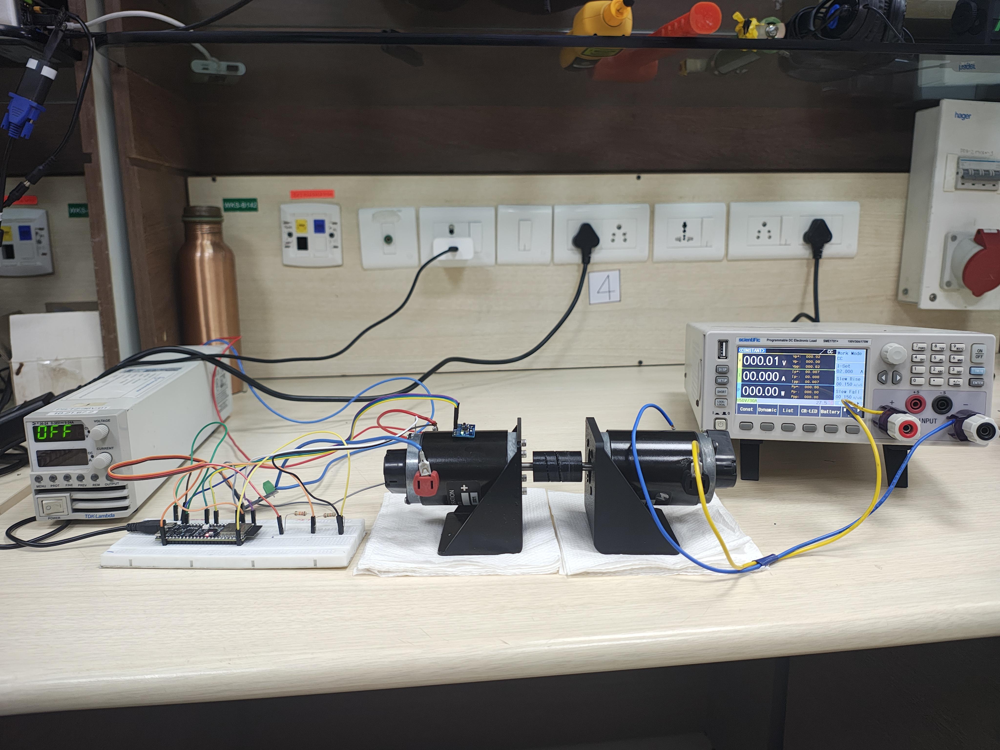
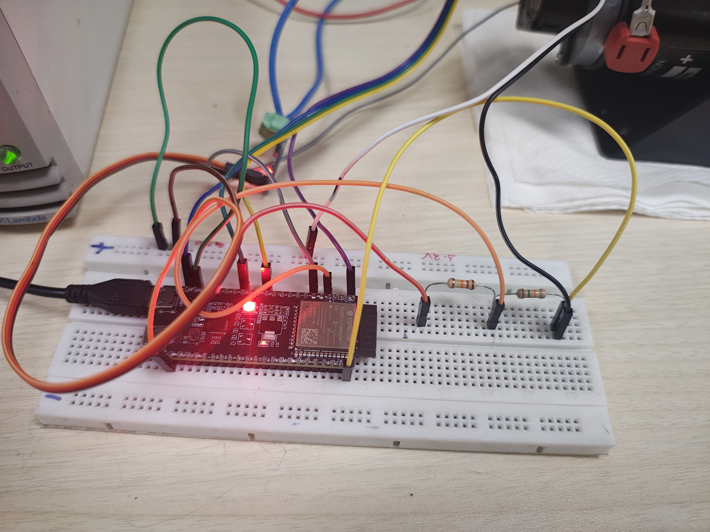
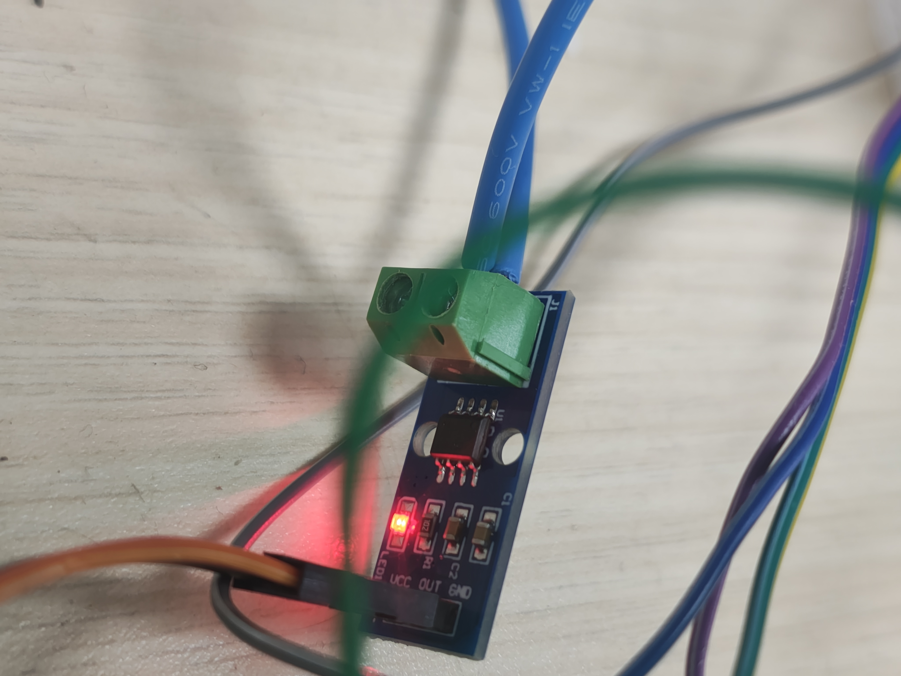
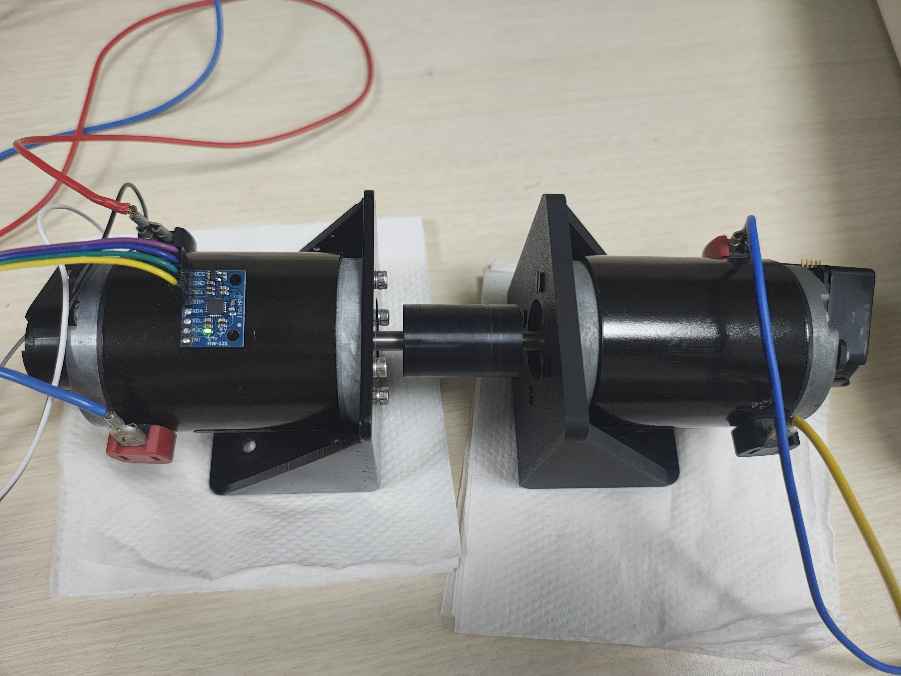
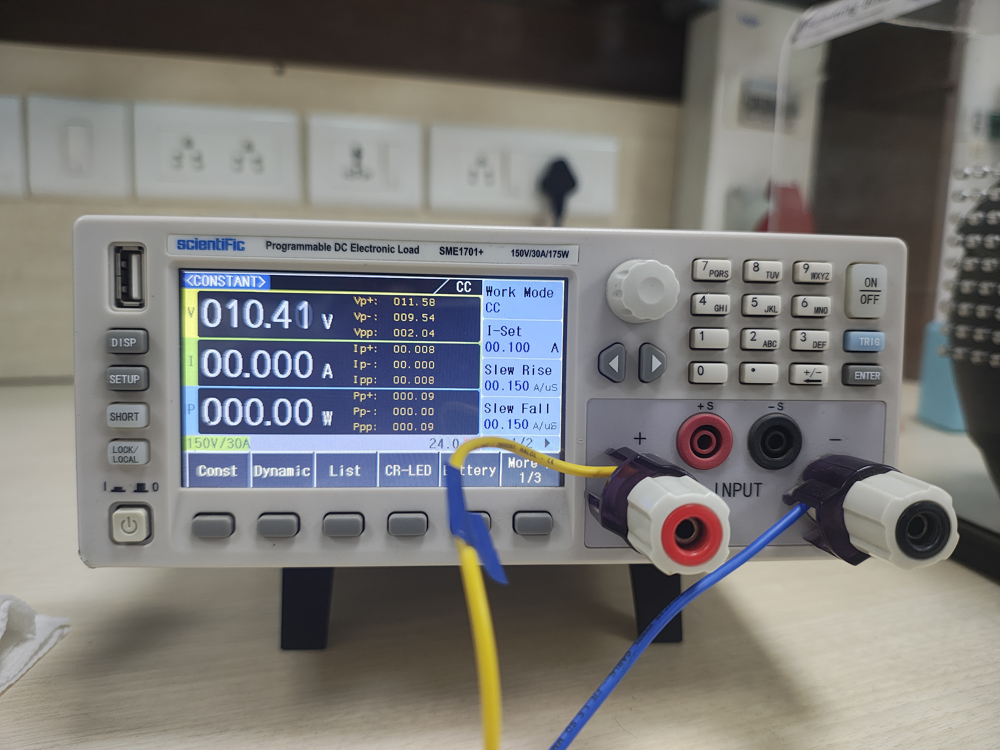
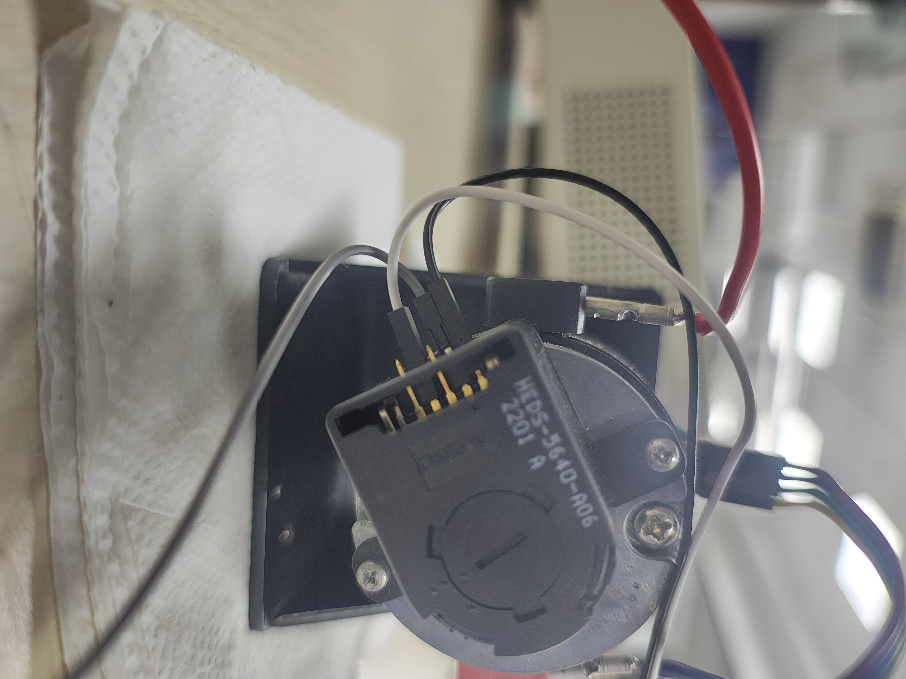
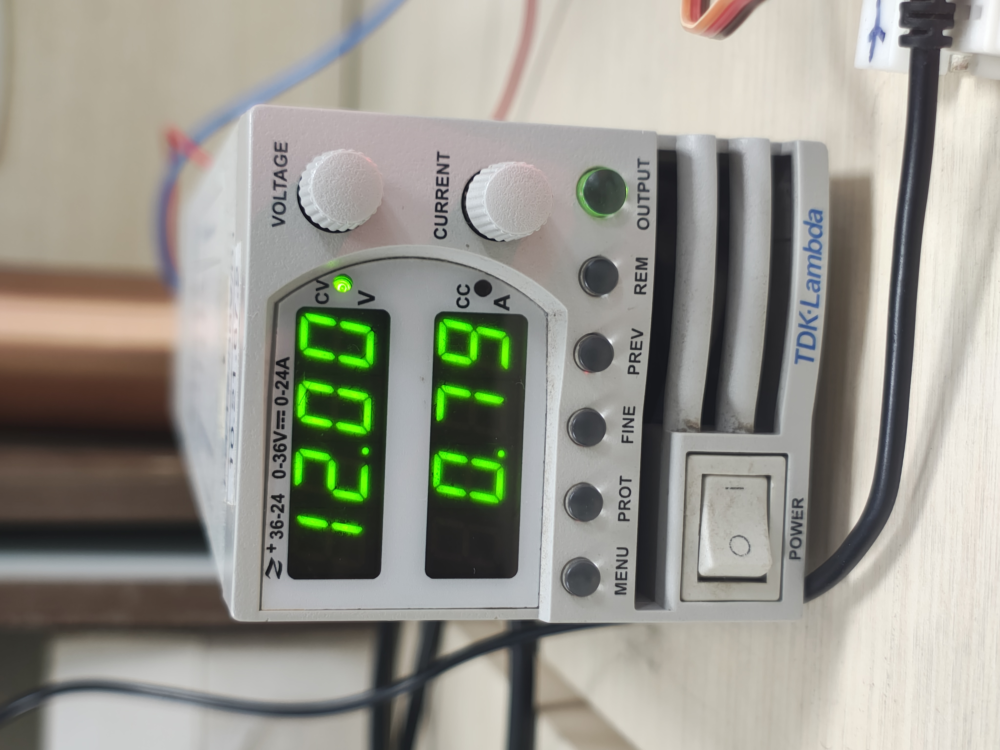

# Edge AI Predictive Maintenance (PDM) System


A complete end-to-end **Edge AI Predictive Maintenance (PDM)** system for real-time motor condition monitoring, machine-learning-based fault classification, and embedded inference.

The project combines **sensor data acquisition, signal processing, feature engineering, machine learning, and embedded Edge AI inference** into a single predictive-maintenance platform. The current stable build streams telemetry over serial; Wi-Fi dashboard integration is planned as the next stage (see the Wi-Fi Dashboard (Deferred) section below).

Developed as part of the **M.Tech in Applied AI and Communications program at VNIT**.

---

## 📖 Overview

Predictive maintenance aims to identify abnormal machine behavior before it develops into a major failure.

This project implements a laboratory-scale predictive-maintenance system for a DC motor using an **ESP32-S3 microcontroller** as the edge-processing device.

The system continuously measures:

- Motor vibration using an **MPU6050 accelerometer**
- Motor/load current using an **ACS712 current sensor**
- Motor speed using an **HEDS-5640 optical encoder**

The acquired sensor signals are processed locally on the ESP32-S3. Features are extracted from rolling data windows and supplied directly to an embedded **Random Forest classifier**.

The classifier identifies the motor operating condition as one of five classes:

1. **HEALTHY**
2. **F1 – Repeat Load-Step Condition**
3. **F2 – Step Load Increase**
4. **F3 – Current-Spike Condition**
5. **F4 – Undervoltage Condition**

The prediction, confidence, motor speed, and other telemetry are printed as **JSON lines over the serial port** (115200 baud) by the ESP32-S3 firmware in `hardware/esp32-pdm/pdm_enhanced/`.

A Wi-Fi HTTP server and browser dashboard were built and tested earlier, but were removed from the stable build because of latency issues. They are planned for integration once the current issues are resolved.

---

# ✨ Features

### Edge AI Inference

- Random Forest machine-learning model embedded directly into the ESP32-S3 firmware.
- No cloud server is required for model inference.
- Prediction is performed locally at the edge.
- Current embedded model contains:
  - **12 input features**
  - **35 decision trees**
  - **5 output classes**

### Multi-Sensor Motor Monitoring

The physical implementation combines:

- MPU6050 accelerometer
- ACS712 current sensor
- HEDS-5640 optical encoder for RPM measurement

This allows the model to use vibration, electrical-current, and rotational-speed information simultaneously.

### Real-Time Data Acquisition

- Sampling frequency: **200 Hz**
- Circular buffer: **200 samples**
- One-second rolling analysis window
- ML inference performed every **250 ms**

### Embedded Feature Extraction

The firmware calculates features from the acquired sensor data before passing them to the embedded ML model.

The deployed feature set includes vibration, current, and RPM-related characteristics.

### Serial Telemetry (Current Stable Build)

The stable firmware prints one JSON object per inference window (every 250 ms) over the serial port:

```json
{"ts":12345,"pred":"HEALTHY","health":93.4,"conf":88.0,"rpm":2898.0,"slope":1.2,"dI_dt":0.4}
```

Fields: `ts` (ms since boot), `pred` (class label), `health` (P(HEALTHY) × 100), `conf` (top-class probability × 100), `rpm` (median RPM in the window), `slope` (RPM slope, RPM/s), `dI_dt` (current slope, ADC counts/s).

The on-device health index is `100 × P(HEALTHY)`. The Isolation Forest anomaly gate used in the Python pipeline is **not** part of the firmware yet.

### Wi-Fi Dashboard (Deferred)

A Wi-Fi build (HTTP dashboard and `/api/data` endpoint, source in `hardware/esp32-pdm/src/main.cpp`) was implemented and tested. It was dropped from the stable build because of observed latency issues. It is not part of the current stable build, and the features below are planned, not active:

- HTTP dashboard served from the ESP32-S3
- `/api/data` JSON endpoint
- Browser-side polling for prediction and telemetry

These will be integrated after the current feature-pipeline issues are resolved.

### Prediction Smoothing

Temporal prediction smoothing is implemented in the firmware to reduce unstable class transitions caused by individual noisy inference windows.

### Visual Status Indication

The ESP32 uses an RGB NeoPixel status LED to provide a local indication of the detected motor condition.

---

# 🏗️ Overall System Architecture

```text
                    PHYSICAL MOTOR SYSTEM
                            │
              ┌─────────────┼─────────────┐
              │             │             │
              ▼             ▼             ▼
         MPU6050         ACS712       HEDS-5640
       Vibration         Current       Encoder/RPM
              │             │             │
              └─────────────┼─────────────┘
                            │
                            ▼
                      ESP32-S3
                            │
                    Sensor Acquisition
                            │
                            ▼
                    Feature Extraction
                            │
                            ▼
                 Embedded Random Forest
                       Edge AI Model
                            │
                            ▼
                 Prediction + Confidence
                            │
              ┌─────────────┴─────────────┐
              │                           │
              ▼                           ▼
        NeoPixel LED                Serial JSON (115200 baud)
                                          │
                                          ▼
                              (planned: Wi-Fi / Browser Dashboard)
```

The complete Edge AI processing pipeline is:

```text
Sensors
   ↓
Data Acquisition
   ↓
Rolling Window
   ↓
Feature Extraction
   ↓
Random Forest Inference
   ↓
Prediction Smoothing
   ↓
Motor Health Classification
   ↓
Serial JSON Telemetry
   ↓
(planned) Wi-Fi Web Dashboard
```

---

# ⚙️ Hardware Apparatus

The physical test apparatus consists of a DC motor test bench, sensing hardware, an embedded processing unit, a laboratory DC power supply, and a programmable electronic load.

## Complete Apparatus

The main hardware arrangement includes:

1. **ESP32-S3 DevKitC-1** — edge processing and embedded ML inference
2. **MPU6050** — vibration/acceleration sensing
3. **ACS712** — current sensing
4. **HEDS-5640** — optical encoder for motor speed/RPM measurement
5. **DC motor pair** — mechanically coupled motor arrangement used for the experimental setup
6. **TDK-Lambda 36-24 laboratory DC power supply** — motor power source
7. **Scientific SME1701+ programmable DC electronic load** — controlled electrical loading
8. Breadboard and jumper wiring for sensor/ESP32 connections
9. Mechanical coupling between the two motors
10. Tachometer used during experimentation to independently verify RPM measurements

---

## 📷 Apparatus Photographs


### Complete Motor and Sensor Setup



### ESP32-S3 Edge AI Controller



### ACS712 Current Sensor



### Mechanically Coupled Motors with MPU6050



### Programmable DC Electronic Load



### HEDS-5640 Optical Encoder



### TDK Lambda PSU



---

# 🔧 Hardware Components

## 1. ESP32-S3 DevKitC-1

The **ESP32-S3 DevKitC-1** is the primary edge-computing platform.

It performs:

- Sensor acquisition
- Rolling-window management
- Feature extraction
- Random Forest inference
- Prediction smoothing
- JSON telemetry generation over serial

Wi-Fi communication and dashboard hosting are planned for a later stage (see the Wi-Fi Dashboard (Deferred) section below).

The ML model therefore runs directly on the microcontroller rather than requiring a separate PC or cloud inference service.

---

## 2. MPU6050 Accelerometer

The MPU6050 is mounted on the monitored motor and is used to acquire three-axis acceleration data:

```text
Ax
Ay
Az
```

The acceleration measurements are used for vibration analysis and feature extraction.

The current firmware configures the accelerometer for:

- Accelerometer range: **±4 g**
- Filter bandwidth: **94 Hz**

---

## 3. ACS712 Current Sensor

An **ACS712 current sensor** is used to monitor the electrical current associated with the experimental motor/load system.

The ESP32 reads the sensor through its ADC input.

Current-derived information is used by the predictive-maintenance model along with vibration and RPM features.

The system extracts current-related characteristics such as:

- Current variation
- Peak-to-peak current
- Current slope / rate of change
- Other statistical current features during the training pipeline

---

## 4. HEDS-5640 Optical Encoder

The motor speed is measured using an **HEDS-5640 optical encoder**.

The encoder provides pulse information to the ESP32-S3, which is used to calculate motor rotational speed in **RPM**.

The encoder signal is processed using an interrupt-based input.

The firmware includes:

- Encoder pulse measurement
- Debouncing (2 ms)
- Minimum valid pulse period (8 ms)
- RPM calculation
- RPM outlier protection (0 < RPM ≤ 5000)

Note: the Python feature pipeline also applies a median filter and a jump limit (1000 RPM) to the RPM signal. The firmware does not yet implement the jump limit (see Known Issues in the Limitations section).

RPM was also independently checked using a tachometer during the data-collection process.

The encoder is an important part of the current implementation because RPM features help distinguish operating conditions that affect motor speed.

---

## 5. Mechanically Coupled DC Motors

The experimental apparatus uses **two DC motors mechanically coupled through a shaft coupling**.

The arrangement allows the second motor to be used as the load/generator side of the test setup.

The monitored motor is supplied from the laboratory DC power supply, while the mechanically coupled motor is associated with the programmable electronic load.

The mechanical arrangement allows controlled electrical operating conditions to be introduced while monitoring the response of the motor system.

---

## 6. TDK-Lambda 36-24 DC Power Supply

The motor system is powered using a **TDK-Lambda 36-24 laboratory DC power supply**.

The front panel shown in the project photographs is marked:

```text
36-24
0–36 V
0–24 A
```

During the current experiments, the motor supply is operated around the **12 V DC** operating condition.

The programmable voltage output also enables controlled undervoltage experiments.

### Placeholder

```text

```

---

## 7. Scientific SME1701+ Programmable DC Electronic Load

A **Scientific SME1701+ Programmable DC Electronic Load** is used to provide controlled electrical loading.

The instrument shown in the project photographs is marked:

```text
SME1701+
150 V / 30 A / 175 W
```

The electronic load is used to create controlled operating conditions such as:

- Constant-current loading
- Load-step changes
- Repeated load transitions
- Current-spike scenarios
- Other controlled electrical conditions used during data collection

These controlled conditions form the basis of the F1–F4 experimental classes.

### Placeholder

```text

```

---

# 🔌 ESP32-S3 Pin Configuration

The stable firmware (`hardware/esp32-pdm/pdm_enhanced/embedded/src/main.cpp`) uses the following pins:

| Function | ESP32-S3 Pin |
|---|---:|
| MPU6050 SDA | GPIO 8 |
| MPU6050 SCL | GPIO 9 |
| ACS712 ADC | GPIO 4 |
| HEDS-5640 Encoder Index | GPIO 6 |
| RGB Status LED | GPIO 38 |

---

# 📡 Sensor Acquisition

The firmware operates at a sampling frequency of:

```text
200 Hz
```

Each sensor window contains:

```text
200 samples
```

Therefore:

```text
200 samples / 200 Hz = 1 second
```

The firmware uses a circular buffer to continuously maintain the latest one-second window.

ML inference is triggered every:

```text
50 samples
```

which corresponds to:

```text
50 / 200 Hz = 250 ms
```

Therefore, the system continuously evaluates the motor condition using overlapping one-second windows.

---

# 📊 Sensor Data

The raw data acquisition pipeline records:

```text
timestamp_ms
ax
ay
az
acs_adc
rpm
```

Where:

- `ax` = acceleration along X-axis
- `ay` = acceleration along Y-axis
- `az` = acceleration along Z-axis
- `acs_adc` = ACS712 ADC measurement
- `rpm` = motor rotational speed

RPM measurements were independently verified using a tachometer during the experimental data-collection process.

---

# 🧮 Feature Engineering

The machine-learning pipeline initially extracts a larger feature set from the raw sensor recordings.

The training pipeline (`hardware/esp32-pdm/pdm_enhanced/data_processing/feature_extractor.py`) computes:

```text
53 candidate features per 1-second window
```

These features include statistical, vibration, electrical-current, spectral/order-tracking, electromechanical, and RPM characteristics.

### Vibration Features

- Mean
- Standard deviation
- RMS
- Peak
- Peak-to-peak
- Crest factor

### Current Features

- Mean
- Standard deviation
- RMS
- Minimum
- Maximum
- Peak-to-peak

### Spectral Features

- Dominant frequency
- Dominant amplitude
- Spectral energy
- Spectral centroid

### RPM Features

- Mean RPM
- Minimum RPM
- Median RPM
- Maximum RPM
- RPM variation

The final embedded model uses a compact **12-feature representation** selected by feature importance, suitable for microcontroller deployment.

---

# 🤖 Machine Learning Model

The current predictive-maintenance classifier is a:

**Random Forest Classifier**

The deployed (embedded) model is trained with:

```text
Number of trees:        35
max_depth:              6
max_features:           sqrt
min_samples_leaf:       2
class weighting:        balanced_subsample
random_state:           42
```

A 300-tree, 53-feature model is trained alongside it as a comparison baseline.

The model is validated using:

```text
StratifiedGroupKFold
```

with:

```text
5 folds
```

and the **recording file** is used as the grouping variable.

This is important because multiple one-second windows are extracted from the same recording. Randomly splitting individual windows could therefore cause data leakage between training and validation sets.

---

# 🧠 Embedded AI Model

The deployed ESP32-S3 model is a compact embedded Random Forest representation.

Current embedded model:

```text
Input features : 12
Decision trees  : 35
Output classes  : 5
```

The embedded feature vector contains:

```text
1.  rpm_min
2.  rpm_median
3.  rpm_slope_rpm_per_s
4.  rpm_p2p
5.  acs_dI_dt_slope
6.  acs_p2p
7.  az_mean
8.  ay_rms
9.  ay_p2p
10. ax_crest
11. order_2x_energy
12. az_std
```

The generated embedded model is stored in:

```text
hardware/esp32-pdm/pdm_enhanced/embedded/include/pdm_model.h
```

It is generated by `pdm_enhanced/embedded/export_c_header.py` and should not be manually edited.

---

# 🚨 Motor Condition Classes

The current physical implementation uses five classes.

| Class | Description |
|---|---|
| `HEALTHY` | Normal motor operation |
| `F1` | Repeat load-step condition |
| `F2` | Step load increase |
| `F3` | Current-spike condition |
| `F4` | Undervoltage condition |

These classes represent the controlled operating/fault scenarios used during the current laboratory experiments.

They should not be interpreted as universal physical motor-failure categories.

---

# 📚 Dataset

The current experimental dataset contains:

```text
1122 one-second windows
53 candidate features
45 independent recording groups
```

Class distribution:

| Class | Windows |
|---|---:|
| HEALTHY | 910 |
| F1 | 68 |
| F2 | 21 |
| F3 | 32 |
| F4 | 91 |
| **Total** | **1122** |

The dataset was generated from:

```text
33 Healthy recordings
12 Fault recordings
45 Total recordings
```

The healthy recordings were collected across multiple controlled load conditions.

---

# 🧪 Healthy Operating Conditions

Healthy motor data was collected across controlled load points including:

```text
0.1 A
0.2 A
0.3 A
0.4 A
0.5 A
0.6 A
0.7 A
0.8 A
0.9 A
1.0 A
2.0 A
```

Three iterations were collected for the healthy operating conditions.

---

# ⚠️ Controlled Fault Conditions

The current experiments prioritize electrically induced operating abnormalities.

### F1 — Repeat Load Step

```text
repeat_cc_0.4_0.8A
```

### F2 — Step Load Increase

```text
stepup_cc_0.3_1A
```

### F3 — Current Spike

```text
spike_cc_0.2_1A
```

### F4 — Undervoltage

```text
UV_cc_1A_9V_12V
```

Three recordings were collected for each fault scenario (12 fault recordings in total).

---

# 📈 Model Validation

The deployed 12-feature Random Forest was evaluated using **5-fold StratifiedGroupKFold** cross-validation, grouped by recording file (45 groups). Results are out-of-fold predictions over all 1122 windows (`pdm_enhanced/models/saved_models/validation_report.txt`):

| Metric | Result |
|---|---:|
| Accuracy | **90.91%** |
| Balanced Accuracy | **79.82%** |
| Macro F1 | **0.770** |
| Weighted F1 | **≈ 0.91** |

For reference, always predicting HEALTHY would score about 81% accuracy (910 of 1122 windows), so balanced accuracy and macro F1 are the more informative metrics.

### Class-wise Performance

| Class | Precision | Recall | F1 |
|---|---:|---:|---:|
| HEALTHY | 0.96 | 0.94 | 0.95 |
| F1 | 0.64 | 0.94 | 0.76 |
| F2 | 0.61 | 0.52 | 0.56 |
| F3 | 0.72 | 0.91 | 0.81 |
| F4 | 0.89 | 0.68 | 0.77 |

> **Important:** 90.91% is a group-aware cross-validation result on the current controlled laboratory dataset. It should not be interpreted as universal real-world motor-fault detection accuracy.

There are currently only 45 independent recordings, with three independent recordings for each fault scenario. F2 is the weakest class (21 windows, 52% recall). Additional experiments are required to establish broader generalization.

---

# 🔍 Important Features

Feature-importance analysis identified several important features for classification.

The highest-ranked features in the full 53-feature model (`pdm_enhanced/models/saved_models/feature_importance.csv`) are:

```text
1.  rpm_min
2.  az_mean
3.  rpm_median
4.  ay_rms
5.  ay_std
6.  ax_kurt
7.  rpm_p2p
8.  ay_p2p
9.  rpm_cv_percent
10. az_std
```

RPM-derived features rank highly. Because the F4 (undervoltage) recordings also run at lower speed, these features may partly capture the operating point of each recording rather than the fault itself. This is an open question for further experiments.

---

# 💻 Embedded Inference Pipeline

The physical ESP32-S3 firmware follows this sequence:

```text
MPU6050 + ACS712 + HEDS-5640 Encoder
                  ↓
            200 Hz Sampling
                  ↓
             Circular Buffer
                  ↓
             200-Sample Window
                  ↓
             Feature Extraction
                  ↓
             12-Feature Vector
                  ↓
           Embedded Random Forest
                  ↓
              Class Prediction
                  ↓
             Temporal Smoothing
                  ↓
            Health + Confidence
```

Inference is performed directly on the ESP32-S3.

The raw sensor window does **not** need to be uploaded to the cloud for classification.

---

# 🔄 Prediction Smoothing

Individual sensor windows can produce temporary prediction changes because of noise and transient operating conditions.

The firmware therefore applies temporal prediction smoothing before presenting the final motor condition: the reported class is the majority vote over the last three inference windows (about 750 ms of history at 250 ms per window).

This reduces unstable class transitions and produces a more useful real-time health indication.

---

# 📶 Serial Output (Current Stable Build)

The stable firmware does not connect to Wi-Fi. Telemetry is available on the USB serial port:

```bash
pio device monitor -d hardware/esp32-pdm/pdm_enhanced/embedded --baud 115200
```

Each inference window prints one JSON line (see the Serial Telemetry section under Features). The same stream can be captured to a file and analysed offline, or forwarded by a host script.

---

# 🌐 Wi-Fi Dashboard (Deferred)

The earlier Wi-Fi build (`hardware/esp32-pdm/src/main.cpp`) connected to the local network, served a browser dashboard, and exposed `/api/data`. It is not part of the stable build because of observed latency. The planned integration will restore these features once the current feature-pipeline issues are resolved.

Planned design (not yet active):

```text
Laptop Browser
       │
       │ HTTP
       ▼
   ESP32-S3
       │
       ▼
 /api/data (JSON)
       │
       ▼
 Live prediction + telemetry
```

Planned fields for `/api/data` mirror the serial JSON, plus temperature.

---

# 💡 Local Status Indication

The ESP32-S3 also provides local visual feedback using a NeoPixel RGB LED.

The LED is connected to:

```text
GPIO 38
```

This provides an immediate physical indication of the current system state without requiring a laptop.

| LED | Meaning |
|---|---|
| 🟢 Green | HEALTHY |
| 🟠 Amber | F1 – Repeat load step |
| 🟡 Yellow | F2 – Step load increase |
| 🟣 Purple | F3 – Current spike |
| 🔴 Red | F4 – Undervoltage (also used for MPU6050 init failure) |
| 🔵 Blue | Calibration, insufficient valid RPM, or unknown class |

The LED shows the majority-vote class from the last three windows.

---

# 📂 Project Structure

The repository contains both the original software/simulation work and the new physical ESP32-S3 Edge AI implementation.

```text
edge-ai-pdm/
│
├── DUDU-BLDC/
│   └── DUDU-BLDC/
│
├── Docs/
├── bldc_pdm/
├── data/
├── models/
├── src/
├── tools/
│
├── hardware/
│   └── esp32-pdm/
│       │
│       ├── pdm_enhanced/              ← CURRENT STABLE BUILD
│       │   ├── README.md
│       │   ├── data/                  (ML dataset, manifest, feature list)
│       │   ├── data_processing/       (feature extractor, dataset builder)
│       │   ├── models/                (training, anomaly detector, health index)
│       │   │   └── saved_models/      (RF + anomaly artifacts, validation report)
│       │   ├── inference/             (offline predictor and CLI)
│       │   ├── embedded/              (ESP32-S3 firmware, PlatformIO project)
│       │   │   ├── include/pdm_model.h
│       │   │   └── src/main.cpp
│       │   └── tests/                 (unit, inference and parity tests)
│       │
│       ├── dataset_v3/                (previous dataset pipeline)
│       ├── embedded_model_v2/         (previous embedded model)
│       ├── include/
│       │   └── pdm_model.h            (previous model header)
│       ├── lib/
│       ├── log_file/                  (raw recordings)
│       ├── src/
│       │   └── main.cpp               (deferred Wi-Fi build)
│       ├── test/
│       ├── PDM_Project_Chat_Handoff.md
│       └── platformio.ini             (builds the deferred Wi-Fi build)
│
├── IMPLEMENTATION_LOGS.md
├── README.md
├── VIVA_PREP.md
├── findings.md
├── progress.md
├── task_plan.md
├── gemini.md
└── pyproject.toml
```

---

# 🧪 Current Pipeline: `pdm_enhanced`

The current pipeline lives in `hardware/esp32-pdm/pdm_enhanced/`. Its own README gives the full details. Run these commands from `hardware/esp32-pdm`:

```bash
PYTHONPATH=. python3 pdm_enhanced/data_processing/dataset_builder.py   # rebuild the dataset
PYTHONPATH=. python3 pdm_enhanced/models/train_and_evaluate.py        # train and validate
PYTHONPATH=. python3 pdm_enhanced/embedded/export_c_header.py         # export pdm_model.h
PYTHONPATH=. python3 -m unittest discover -s pdm_enhanced/tests -t .  # run tests
```

Dependencies are pinned in the root `uv.lock`. Run with `uv run --frozen` from the repository root.

---

# 🧪 Dataset Version 3 (Previous Pipeline)

The `dataset_v3` directory contains the earlier dataset-generation and model-training pipeline. It is kept for reference and is superseded by `pdm_enhanced`.

The updated labeling strategy distinguishes:

- Healthy baseline/recovery windows
- F1 event windows
- F2 event windows
- F3 event windows
- F4 event windows

The main scripts are:

```text
dataset_v3/build_dataset_v3.py
dataset_v3/train_model_v3.py
```

From the `hardware/esp32-pdm` directory:

```bash
python dataset_v3/build_dataset_v3.py
python dataset_v3/train_model_v3.py
```

---

# ⚙️ Embedded Model Version 2

The repository also contains:

```text
hardware/esp32-pdm/embedded_model_v2/
```

This development version focuses on a compact Random Forest deployment for ESP32-based inference.

The embedded-model development explored reducing the number of trees while retaining vibration, RPM, and current information.

---

# 🔨 ESP32-S3 Setup

The stable physical deployment uses:

- ESP32-S3 DevKitC-1
- Arduino framework
- PlatformIO
- Adafruit MPU6050 library
- Adafruit NeoPixel library

The PlatformIO configuration for the stable build is located at:

```text
hardware/esp32-pdm/pdm_enhanced/embedded/platformio.ini
```

---

# 🚀 Build and Upload the Firmware

From the repository root, build the stable firmware:

```bash
pio run -d hardware/esp32-pdm/pdm_enhanced/embedded
```

Upload it to the ESP32-S3:

```bash
pio run -d hardware/esp32-pdm/pdm_enhanced/embedded -t upload
```

Open the serial monitor:

```bash
pio device monitor -d hardware/esp32-pdm/pdm_enhanced/embedded --baud 115200
```

The serial monitor operates at:

```text
115200 baud
```

> The root-level `hardware/esp32-pdm/platformio.ini` builds the earlier Wi-Fi firmware (`hardware/esp32-pdm/src/main.cpp`). It is not the stable build.

---

# 📡 Running the Stable Firmware

After flashing the firmware:

1. Power the ESP32-S3 and connect the sensors.
2. Open the serial monitor.
3. Wait for the zero-current calibration message and `Sampling started @ 200 Hz`.
4. Observe one JSON telemetry line every 250 ms once the 1-second buffer is full.
5. Watch the NeoPixel LED for the current class (see the LED status codes in the Pipeline section).

---

# 🔐 Wi-Fi Security (For the Deferred Wi-Fi Build)

**Do not commit real Wi-Fi passwords to the public GitHub repository.**

The earlier Wi-Fi firmware (`hardware/esp32-pdm/src/main.cpp`, lines 48–49) currently contains a hard-coded SSID and password. These should be replaced with placeholders or moved to a local configuration mechanism that is excluded from Git before the Wi-Fi build is re-integrated.

If an actual Wi-Fi password has already been committed to a public repository, it should be changed.

---

# 🖥️ Original Digital Twin / Simulation

The repository also retains the earlier software-based predictive-maintenance and simulation components.

These components were developed before the physical ESP32-S3 implementation and provide a software environment for:

- Data processing
- Machine-learning experimentation
- Digital-twin visualization
- ESP32 simulation
- Model evaluation

Therefore, the repository contains both:

```text
Software / Simulation
        +
Physical Edge AI
```

The physical ESP32-S3 implementation is now the primary real-time Edge AI deployment.

---

# 🔬 Development Phases

## Phase 1 — Data Engineering

- Defined raw sensor data schema.
- Collected motor sensor recordings.
- Added vibration, current, and RPM measurements.
- Developed preprocessing and windowing.
- Added RPM diagnostics and validation.

## Phase 2 — Experimental Dataset

- Collected healthy operating data.
- Collected controlled fault-condition data.
- Added electrical fault scenarios.
- Created grouped one-second ML windows.
- Developed updated dataset labeling.

## Phase 3 — Feature Engineering

- Developed vibration features.
- Developed current features.
- Developed spectral features.
- Added RPM features.
- Evaluated feature importance.
- Reduced the feature set for embedded deployment.

## Phase 4 — Machine Learning

- Trained Random Forest models.
- Implemented group-aware validation.
- Evaluated accuracy, balanced accuracy, precision, recall, and F1.
- Selected a compact model suitable for embedded inference.

## Phase 5 — ESP32-S3 Deployment (`pdm_enhanced`, stable)

- Integrated MPU6050.
- Integrated ACS712.
- Integrated HEDS-5640 optical encoder.
- Implemented 200 Hz acquisition.
- Implemented circular buffering.
- Implemented embedded feature extraction.
- Integrated Random Forest inference.
- Added prediction smoothing.
- Added serial JSON telemetry and local NeoPixel status indication.

## Phase 6 — Wireless Monitoring (Deferred)

- Implemented Wi-Fi connectivity, an HTTP server, a `/api/data` JSON endpoint, and a browser dashboard in an earlier build (`src/main.cpp`).
- Tested the build; dropped from the stable build due to latency issues.
- Pending: resolve the feature-pipeline issues first, then re-integrate the dashboard.

---

# 🧩 Simulation vs Physical Edge AI

The project has evolved from a software-based predictive-maintenance prototype into a physical Edge AI system.

### Earlier architecture

```text
Sensor / Simulated Data
        ↓
Python
        ↓
Feature Extraction
        ↓
ML Model
        ↓
Streamlit Dashboard
```

### Current physical architecture

```text
Motor
  ↓
MPU6050 + ACS712 + HEDS-5640 Encoder
  ↓
ESP32-S3
  ↓
Feature Extraction
  ↓
Embedded Random Forest
  ↓
Prediction
  ↓
Serial JSON telemetry
  ↓
(planned) Wi-Fi Browser Dashboard
```

The key difference is that the current system performs **machine-learning inference directly on the ESP32-S3** rather than depending on a laptop or cloud server.

---

# 📌 Current System Summary

| Parameter | Current Implementation |
|---|---|
| Edge Device | ESP32-S3 DevKitC-1 |
| Framework | Arduino |
| Build System | PlatformIO |
| Accelerometer | MPU6050 |
| Current Sensor | ACS712 |
| Speed Sensor | HEDS-5640 Optical Encoder |
| Motor Arrangement | Mechanically coupled DC motor pair |
| Motor Supply | TDK-Lambda 36-24 DC supply |
| Programmable Load | Scientific SME1701+ |
| Sampling Rate | 200 Hz |
| Window Size | 200 samples |
| Window Duration | 1 second |
| Inference Interval | 250 ms |
| ML Algorithm | Random Forest |
| Embedded Trees | 35 |
| Embedded Features | 12 |
| ML Candidate Features | 53 |
| Classes | 5 |
| Recording Groups | 45 |
| ML Windows | 1122 |
| CV Accuracy | 90.91% |
| Balanced Accuracy | 79.82% |
| Macro F1 | 0.770 |
| Communication | USB serial, 115200 baud (Wi-Fi deferred) |
| Dashboard | Deferred (Wi-Fi build, see above) |
| API | Serial JSON (`/api/data` deferred) |

---

# ⚠️ Limitations

The current system is a **controlled laboratory prototype**.

Important limitations include:

- Only 45 independent recordings are currently available.
- Each fault class has approximately three independent recordings.
- The dataset contains substantially more healthy windows than fault windows.
- Multiple windows originate from the same recording.
- Mechanical fault experiments were not sufficiently reproducible and therefore the current dataset emphasizes controlled electrical/operational abnormalities.
- The current fault classes represent experimental operating scenarios rather than a complete taxonomy of real motor failures.
- Additional motors, operating conditions, loads, and fault severities are required to establish generalization.
- The reported 90.91% accuracy should not be interpreted as universal real-world performance.
- Fault windows overlap by 75% (0.25 s hop), so windows are not statistically independent. Effective sample sizes are smaller than the window counts suggest.
- F2 has only 21 windows from three recordings, so its metrics have high variance.

### Known Issues in the Stable Firmware

These are identified but not yet resolved. They are the first items to address before the Wi-Fi dashboard is re-integrated.

- **`order_2x_energy` is zero above ~3000 RPM.** At 200 Hz sampling, the 2× shaft frequency exceeds the 100 Hz Nyquist limit at about 3000 RPM. Both the Python pipeline and the firmware return 0 in this range. About 18% of training windows (all HEALTHY or F4 at high speed) have this value, so the feature acts partly as a speed-regime flag.
- **Training/serving skew in `order_2x_energy`.** The Python pipeline sums FFT energy over a ±2.5 Hz band at the mean RPM. The firmware uses a single-bin DFT at the median RPM. The model was trained on the Python definition.
- **RPM cleaning is not fully ported.** The Python pipeline applies a median filter and a 1000 RPM jump limit. The firmware applies only the range check. `rpm_min` is the highest-ranked feature, so glitches matter.
- **Anomaly gate not on-device.** The Isolation Forest out-of-distribution gate and the associated health-index cap run only in Python. The on-device health index is 100 × P(HEALTHY).
- **Parity test covers the trees only.** `test_embedded_parity.py` checks tree traversal, not feature extraction. Feature-level parity between Python and firmware has not been verified.
- **Speed confound.** RPM features dominate importance, and F4 runs at a lower speed. The model may partly learn the operating point rather than the fault.
- **Sampling timing not measured on hardware.** Feature constants assume an exact 200 Hz sample rate. Inline inference may cause timing jitter.
- **Library version mismatch.** The saved models were created with scikit-learn 1.9.0, but `uv.lock` pins 1.8.0. Loading the models produces version warnings. Re-export after pinning.

---

# 🔮 Future Work

Future development can include:

- Resolving the Known Issues listed above (feature parity, `order_2x_energy`, RPM cleaning, on-device anomaly gate).
- Re-integrating the Wi-Fi dashboard and `/api/data` endpoint after latency is resolved.
- Increasing the number of independent motor recordings.
- Testing multiple motors.
- Collecting additional fault severities.
- Adding reproducible mechanical fault conditions.
- Testing additional motor speeds and loads.
- Comparing different ML algorithms.
- Optimizing RAM and flash usage.
- Measuring exact ESP32 inference latency.
- Measuring energy consumption.
- Adding MQTT/cloud connectivity where required.
- Adding long-term health-index estimation.
- Remaining Useful Life (RUL) estimation.
- Automated maintenance alerts.
- Improved dashboard visualization.
- Edge-to-cloud fleet monitoring.

---

# 📚 Documentation

Additional project documentation is available in:

```text
hardware/esp32-pdm/pdm_enhanced/README.md   (current pipeline and firmware)
IMPLEMENTATION_LOGS.md
VIVA_PREP.md
PDM_Project_Chat_Handoff.md
findings.md
progress.md
task_plan.md
```

The physical ESP32-S3 implementation is documented under:

```text
hardware/esp32-pdm/
```

---

# 🎓 Academic Context

The project demonstrates the complete lifecycle of an Edge AI predictive-maintenance system:

```text
Data Acquisition
       ↓
Data Preprocessing
       ↓
Feature Engineering
       ↓
Machine Learning
       ↓
Model Validation
       ↓
Model Optimization
       ↓
Embedded Deployment
       ↓
Real-Time Edge Inference
       ↓
Wireless Monitoring
```

The project therefore combines concepts from:

- Artificial Intelligence
- Machine Learning
- Edge Computing
- Embedded Systems
- IoT
- Predictive Maintenance
- Signal Processing
- Industrial Condition Monitoring
- Sensor Fusion

---

# 👨‍💻 Author

**Kartik Burele**

M.Tech in Applied AI and Communications  
VNIT

---

# 📜 License

This project is intended for academic, research, and educational purposes.
